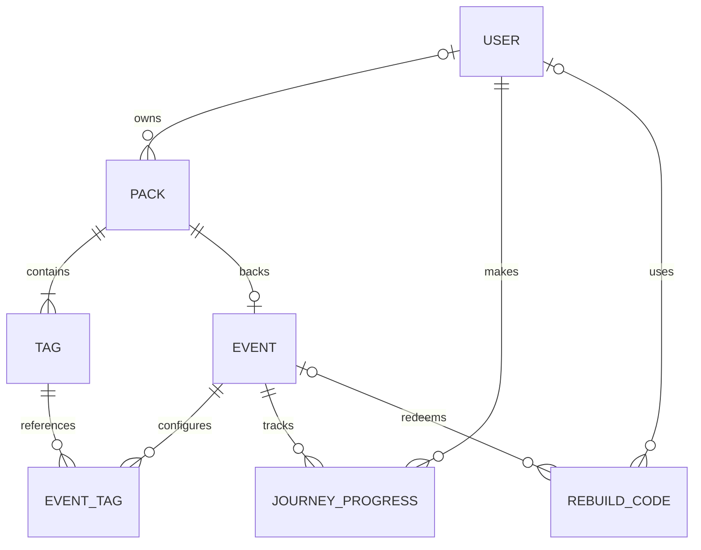
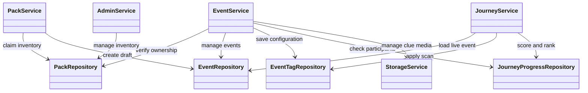
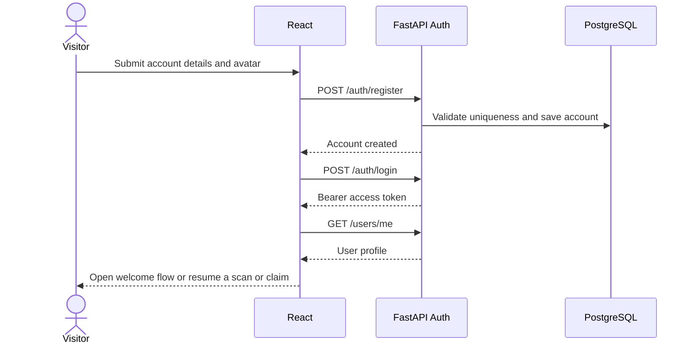
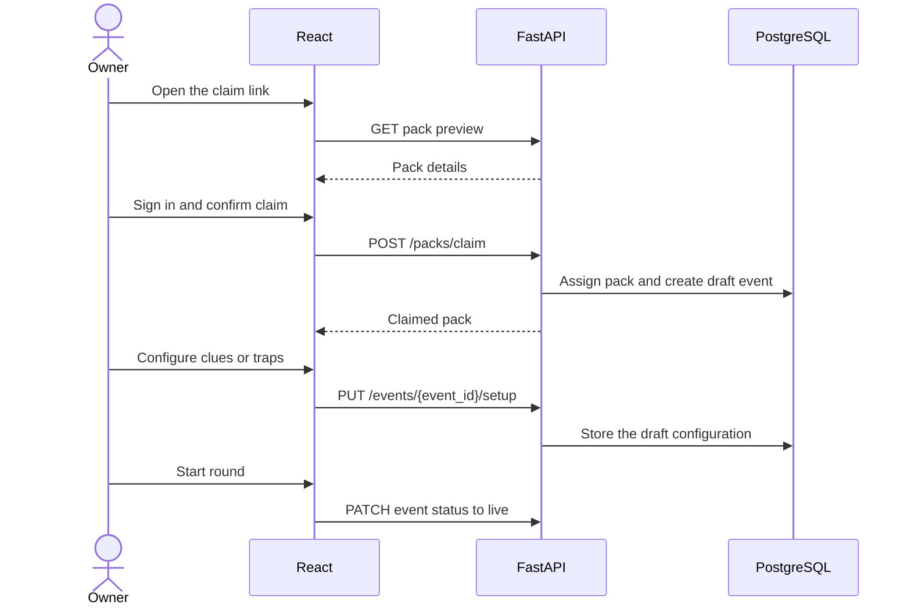
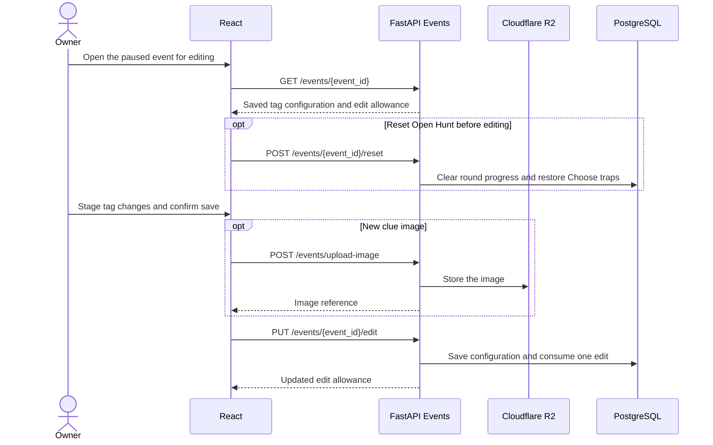
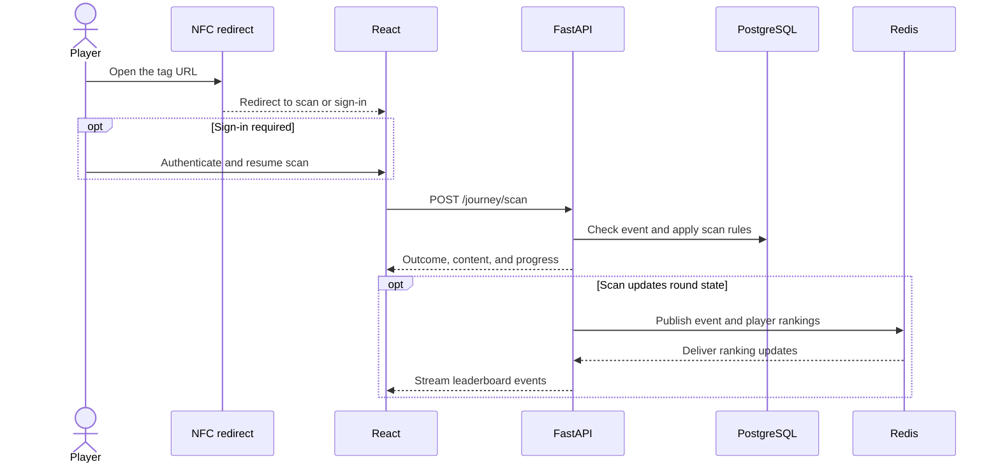
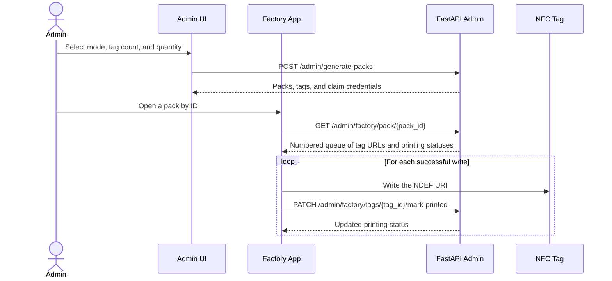

# Raccon Technical Documentation

## Table of Contents

- [Project Overview](#project-overview)
- [Terminology and Domain Rules](#terminology-and-domain-rules)
- [User Stories](#user-stories)
  - [Owner Stories](#owner-stories)
  - [Player Stories](#player-stories)
  - [Admin Stories](#admin-stories)
- [Figma Mockups](#figma-mockups)
- [System Architecture](#system-architecture)
- [High-Level Class Diagram](#high-level-class-diagram)
- [High-Level Sequence Diagrams](#high-level-sequence-diagrams)
- [Raccon REST API Documentation](#raccon-rest-api-documentation)
- [Technical Justifications](#technical-justifications)
- [Requirements Traceability](#requirements-traceability)
- [SCM and QA Plans](#scm-and-qa-plans)

## Project Overview

Raccon will let people create and play physical treasure hunts with NFC tags. Administrators will generate packs and program the physical tags. Customers will browse packs on Raccon, complete their purchase on Ramz, and use a claim link to add the pack to their account. Owners will configure their experience and start a round. Players will tap the tags with their phones to discover clues, encounter traps in Open Hunt, and see their ranking.

## Terminology and Domain Rules

| Term | Meaning |
|---|---|
| Pack | Physical inventory with a fixed tag count and a mode of Sequential (`seq`) or Open Hunt (`open`). A pack is generated before purchase or claim. |
| Tag | Physical NFC item with an internal UUID, a position in its pack, and a public identifier (`static_hash`). |
| Claim link | A URL of the form `https://raccon.app/claim/{master_auth_hash}`. A successful claim assigns the pack to one account and creates its event. |
| Event | The owner’s configurable experience associated with a claimed pack. |
| Event tag | Event-specific clue or trap configuration associated with a physical tag. Its content is stored as JSONB. |
| Journey progress | A player’s score, visited sequences, completion state, and freeze deadline for an event. |
| Rebuild code | A single-use code that returns a paused event to draft and restores its editing allowance. |

### Event lifecycle

- **Draft.** Claiming a pack creates an event in draft. The owner saves its initial configuration through the setup endpoint and then starts the round to make the event live.
- **Paused.** Players cannot scan for progress. The owner can edit the configuration within the available allowance or start a round by setting the event live.
- **Live.** Players can scan tags and progress under the rules of the pack’s mode. The owner pauses the event before editing.
- **Reset.** Resetting clears player progress and Open Hunt clue claims, restores activated Choose traps, and leaves the event paused with its configuration and edit allowance intact. An Open Hunt event with player progress must be reset before editing.
- **Rebuild.** A valid rebuild code clears round progress, returns the event to draft, and resets the edit count. The pack and its programmed NFC URLs stay associated with the event.

The API will check event ownership through the pack’s owner account. Administrative operations require the admin role. A public NFC URL identifies a tag, and player requests also require an authenticated account.

## User Stories

### Owner Stories

The account stories apply to owners and players. Pack management and customization require ownership of the selected pack.

#### US-01 — Registration

> As a visitor, I want to register so I can own or play experiences.

**Acceptance criteria**

- Offer avatar selection with a default avatar.
- Validate name, username, email, phone number, and password before submitting.
- Require unique usernames and email addresses.
- Use a nine-digit phone number in the registration request.
- Load the new account after registration and preserve the destination for visitors arriving from a claim link or scan.

#### US-02 — Log In

> As a registered user, I want to sign in so I can access my account.

**Acceptance criteria**

- Accept a username or an email address with a password.
- Show an error for invalid credentials.
- Offer a password recovery link.
- Load the current profile before displaying authenticated screens.
- Use the Google credential flow to sign in or create a user on first use.
- Resume the pending claim or scan after authentication.

#### US-03 — Log Out

> As a signed-in user, I want to log out so I can end my session on this device.

**Acceptance criteria**

- Expose Log Out in authenticated navigation.
- Send the authenticated logout request and clear the frontend session.
- Redirect to sign-in and require authentication before reopening protected pages.

#### US-04 — Forgot Password

> As a registered user, I want to reset my forgotten password.

**Acceptance criteria**

- Validate the email before submitting a reset request.
- Use a neutral confirmation for registered and unregistered email addresses.
- Send a reset link to matching accounts.
- Collect and compare the new password and its confirmation on the reset page.
- Reject invalid or expired tokens and invalidate the token when the password changes.
- Allow sign-in with the new password.

#### US-05 — Manage Account

> As a registered user, I want to manage my account.

**Acceptance criteria**

- Display profile information and the selected avatar.
- Allow users to edit name, username, phone, and avatar.
- Show the updated profile after saving.
- Require the current password for a password change.
- Ask for confirmation before deleting an account and clear the session after deletion.

#### US-06 — Claim a Purchased Package

> As a customer, I want to claim a pack I purchased so I can configure it.

**Acceptance criteria**

- List pack modes, tag counts, and prices in the store.
- Use the corresponding Ramz product link for checkout.
- Open the claim page at `/claim/{master_auth_hash}` and load the pack preview.
- Preserve the destination through sign-in or registration.
- Submit the authenticated claim after the user confirms.
- Assign the pack and create its draft event in the same database commit.
- Show a claim error for an invalid credential or a pack owned by another customer.
- When the pack belongs to the current account, use its event to link to customization.

#### US-07 — View and Manage Purchased NFC Packages

> As a pack owner, I want to see and manage my experiences.

**Acceptance criteria**

- List the authenticated owner's packs with event title, mode, tag count, and status.
- Give a newly claimed event the title `UnTitled Event`.
- Open the selected event with its saved configuration.
- Limit the title to 20 characters in the editor.
- Save title changes separately from tag configuration.
- Check ownership before every event read or update.

#### US-08 — NFC Package Customization

> As a pack owner, I want to configure numbered tags and control the round.

**Acceptance criteria**

- Show the physical tags in sequence order and select the first tag on entry.
- Indicate which tag is selected and which tags are configured.
- Load the selected tag's saved fields into the editor.
- Stage individual changes locally and submit the configuration in one request on the final save.
- Keep tag identifiers and positions stable.
- Provide controls to start, pause, and reset a round.

#### US-09 — Customize Tag Content

> As a pack owner, I want to add a hint or image to a clue tag.

**Acceptance criteria**

- Allow up to 255 characters of optional hint text and display a character counter.
- Accept JPEG, PNG, and WebP image input.
- Prepare uploads at no more than 2 MiB and 1200 pixels on the longest side in the browser.
- Display image preparation errors in the editor.
- Use the image reference returned by the upload API when saving the configuration.
- Keep the saved hint and image available when the owner returns.

#### US-10 — Edit a Saved Package Configuration

> As a pack owner, I want to revise a saved configuration.

**Acceptance criteria**

- Enable configuration editing for paused events with allowance remaining.
- Stage edits across multiple tags and consume one edit on a successful event-level save.
- Display the available allowance, with three edits as the MVP configuration.
- Require an Open Hunt reset before editing an event with player progress.
- Keep title changes independent of the edit quota.
- Accept a single-use rebuild code for a paused event and restore its quota and draft state.

#### US-11 — Configure Freeze Trap

> As an Open Hunt owner, I want to configure a Freeze trap.

**Acceptance criteria**

- Offer Freeze for Open Hunt tags and store the duration in seconds.
- Allow one trap type per tag.
- Cap the duration at three minutes.
- Apply the freeze to the player who triggers it.

#### US-12 — Configure Boom Trap

> As an Open Hunt owner, I want to configure a Boom trap.

**Acceptance criteria**

- Offer Boom for Open Hunt tags.
- Store a one-point penalty.
- Give a tag one trap type at a time.
- Apply the penalty to the triggering player's score, with a floor of zero.

#### US-13 — Configure Choose Trap

> As an Open Hunt owner, I want to configure a Choose trap.

**Acceptance criteria**

- Offer Choose for Open Hunt tags.
- Ask the player to pick Freeze or Boom when they find an available Choose tag.
- Accept the choice during an active, unfinished round and apply it to that tag.
- Use the selected trap for subsequent eligible scans.
- Restore the Choose state when resetting the round.

### Player Stories

#### US-16 — Scan a Hashed NFC Tag

> As a player, I want to tap an NFC tag with my phone so I can enter the experience.

**Acceptance criteria**

- Program each tag with its stable URL on raccon.link.
- Preserve the tag destination through authentication.
- Submit the tag hash and user context with an authenticated scan request.
- Check that the event is live and that the request matches the current player.
- Return errors for invalid tags and ineligible scans.

#### US-17 — View Successful Sequential Scan Result

> As a Sequential player, I want to see the result of a successful scan so I can find the next tag.

**Acceptance criteria**

- Accept the next clue in numerical order.
- Reject repeats and scans past the next expected position.
- Show the clue text, optional image, and player progress after success.
- Track progress independently for each player and mark completion when they reach the end.

#### US-18 — View Successful Open Hunt Scan Result

> As an Open Hunt player, I want to see the result of my scan and know whether I earned a point.

**Acceptance criteria**

- Allow clue scans in any order.
- Award a clue to its first successful claimant and add one point.
- Distinguish a repeat scan from a clue claimed by another player.
- Show the outcome and current score.
- Complete the round once all configured clues have been claimed.
- Show view-only results for subsequent scans.

#### US-19 — Experience a Freeze Trap

> As an Open Hunt player, I want to know when I am frozen and when I can play again.

**Acceptance criteria**

- Set a freeze deadline when the player triggers a Freeze trap.
- Show the countdown in the scan interface.
- Reject attempts to advance while the freeze is active.
- Allow eligible scans again after the deadline.

#### US-20 — Experience a Boom Trap

> As an Open Hunt player, I want to see the outcome of hitting a Boom trap.

**Acceptance criteria**

- Show the Boom result and the updated score.
- Deduct one point from the player who triggered the trap.
- Keep the score at zero or above.

#### US-21 — View Leaderboard

> As a player, I want to see the leaderboard so I can track my position.

**Acceptance criteria**

- Load a ranked snapshot for the current event.
- Rank by descending score, then ascending scan time, name, and user hash.
- Display each ranked player's position, name, avatar, and score.
- Display the signed-in player's rank if they have progress outside the top ten.
- Stream shared rankings and player-specific position updates.

### Admin Stories

#### US-22 — Prepare an NFC Package

> As an administrator, I want to generate and prepare packs so they can be sold and played.

**Acceptance criteria**

- Restrict inventory generation and factory operations to admins.
- Generate batches by mode, tag count, and quantity.
- Create a claim credential and a numbered set of physical tags for each pack.
- Export raw claim credentials or claim links for fulfillment.
- Load the selected pack and programming queue in the factory tool.
- Write the URL as an NDEF URI and mark the tag printed after the write succeeds.
- Generate batches of single-use rebuild codes.

## Figma Mockups

The design workspace will hold the user stories, sitemap, user flows, and interface mockups. Its foundations will define the brand identity, characters, color and typography tokens, reusable components, and interface copy in Saudi dialect. [Raccon Figma workspace](https://www.figma.com/design/Hdv2zuWiZN8ltgtFmr4mhZ/Raccon-%25E2%2580%2594-User-Stories--Design-System---Mockups?node-id=325-34&p=f&t=XIrNazSEfBlfXD9l-0)

## System Architecture

| Layer | Technology | Responsibility |
|---|---|---|
| Web application | React on Cloudflare Pages | Feature-based screens for accounts, store, claims, packages, customization, gameplay, and administration. Shared modules provide API access, authentication, layout, and UI components. |
| API | FastAPI on Render | Domain routers validate requests with Pydantic, services apply business rules, and repositories handle persistence. |
| Persistence | PostgreSQL, SQLModel, Alembic | Store identity, inventory, configuration, and progress in PostgreSQL. Track schema changes with versioned migrations. |
| Media | Cloudflare R2 | Store uploaded clue images. Event-tag configuration keeps the image reference. |
| Live updates | Redis and server-sent events | Publish leaderboard changes and deliver shared rankings and player-specific updates. |
| NFC factory | Desktop tool and NFC reader/writer | Fetch factory instructions and program tag URLs. |
| External services | Ramz, Google, email delivery, and Axiom | Handle checkout, Google sign-in, password-reset email, and application logs. |

### Entity Relationship Diagram

### Database overview

| Table | Records and relationships | Workflow |
|---|---|---|
| `users` | UUID, public user hash, profile, avatar, credentials, and role | Authenticate owners and players and authorize admins. |
| `packs` | Mode, tag count, claim credential, and optional owner | Generate inventory before sale and associate it with an account at claim time. |
| `tags` | Pack reference, position, public hash, and printing status | Generate production URLs and track factory programming. |
| `events` | Pack reference, title, lifecycle status, and edit count | Track the configurable experience and its edit allowance. |
| `event_tags` | Event and tag references, tag type, and JSONB content | Store clues, trap settings, and round-specific clue claims. |
| `journey_progress` | Event reference, player hash, score, current sequence, visited sequences, freeze deadline, status, and scan timestamp | Enforce scan eligibility and build player results and rankings. |
| `rebuild_codes` | Unique code, redemption state, user and event references, and redemption timestamp | Record single-use restores of the event edit allowance. |

### Request flow

1. The React page collects input and calls its domain API client. Protected requests carry the signed-in user's bearer token.
2. A FastAPI router validates the payload and resolves the authenticated user. An admin operation also checks the user's role.
3. A domain service applies the workflow rules. An owner event request resolves the pack to verify ownership. A scan request resolves the tag, event, player context, and mode.
4. Repositories load and persist SQLModel records. The service commits the ownership change, configuration, or progress update as one unit of work for the operation.
5. The API returns a response for the screen. Accepted gameplay updates can also trigger an asynchronous leaderboard broadcast.

## High-Level Class Diagram

## High-Level Sequence Diagrams

### Registration and authentication

### Pack claim and configuration

### Edit a saved configuration

### NFC scan and leaderboard

### Factory programming

## Raccon REST API Documentation

The API will use JSON for requests and responses except where noted. Protected routes will take an access token in the `Authorization: Bearer` header. Owner and admin operations will also check ownership or role at the API. Event and pack identifiers will use UUIDs. NFC routes will use the tag’s public identifier.

| Area | Method and path | Contract |
|---|---|---|
| Authentication | `POST /auth/register` | Create an account from profile fields and a password. |
| Authentication | `POST /auth/login` | Take form fields `username` and `password`, where the username field also accepts an email. Return a bearer token. |
| Authentication | `POST /auth/google` | Take a Google `credential` and return a Raccon bearer token. |
| Authentication | `POST /auth/logout` | Acknowledge logout. The frontend clears its stored session. |
| Account recovery | `POST /auth/forgot-password`, `POST /auth/reset-password` | Request a reset by email, then submit `token` and `new_password`. |
| Profile | `GET /users/me`, `PATCH /users/me` | Read or update the authenticated user’s profile. |
| Profile | `POST /auth/change-password`, `DELETE /auth/delete-account` | Change the password with `old_password` and `new_password`, or delete the authenticated account. |
| Pack claim | `GET /packs/preview/{master_auth_hash}`, `POST /packs/claim` | Preview pack details publicly. Claim while signed in by submitting `master_auth_hash`. |
| Events | `GET /events`, `GET /events/{event_id}` | List owned events or retrieve one owned event with tag configuration and edit allowance. |
| Events | `PUT /events/{event_id}/setup`, `PUT /events/{event_id}/edit` | Submit `tags_config` entries containing `tag_id`, `tag_type`, and `content` for draft setup or a saved edit. |
| Events | `PATCH /events/{event_id}` | Update the title or status. |
| Events | `POST /events/{event_id}/reset`, `POST /events/{event_id}/rebuild` | Reset the round, or supply a rebuild `code` to return a paused event to draft. |
| Media | `POST /events/upload-image` | Accept a multipart image upload and return its reference. |
| NFC | `GET /t/{tag_hash}` | Redirect the browser to sign-in or the scan screen. |
| Journey | `POST /journey/scan` | Take `tag_hash` and `injected_user_hash`. Return the scan outcome, tag content, score, remaining tags, and completion state for the player. |
| Journey | `POST /journey/set-trap` | Take the tag and player identifiers plus `trap_type` and `trap_value` to activate an available Choose trap. |
| Journey | `GET /journey/progress/{event_id}` | Get the signed-in player’s progress. |
| Rankings | `GET /journey/leaderboard/{event_id}`, `GET /journey/leaderboard/{event_id}/stream` | Fetch the current rankings and subscribe to updates as `text/event-stream`. |
| Admin | `POST /admin/generate-packs`, `POST /admin/generate-rebuild-codes` | Generate packs with tags or issue rebuild codes in batches. |
| Admin | `GET /admin/packs`, `GET /admin/packs/details/{master_auth_hash}`, `GET /admin/users` | List inventory or users and look up pack details. |
| Admin | `DELETE /admin/delete-pack/{pack_id}`, `DELETE /admin/delete-user/{user_id}` | Remove the specified pack or user. |
| Factory | `GET /admin/factory/pack/{pack_id}`, `PATCH /admin/factory/tags/{tag_id}/mark-printed` | Fetch tag URLs and printing status, or mark a tag as printed after programming. |
| Health | `GET /health/` | Return the API health status. |

### Event configuration payloads

Each entry in `tags_config` pairs a physical tag UUID with the event-specific fields to save.

| Tag type | Content keys | Validation |
|---|---|---|
| Clue | `hint`, `image` | Both fields are optional. The editor limits hint length and prepares image uploads before saving the returned URL. |
| Freeze | `freeze` | One trap per tag in Open Hunt. The value is a duration in seconds. |
| Boom | `boom` | One trap per tag in Open Hunt. The value is one point. |
| Choose | `choose` | Set to true in the owner configuration. Player activation saves the selected trap and records its Choose origin for reset. |

Event detail responses return tags in sequence order with their configuration status. They also include the current edit count, the maximum allowance, and the edits remaining. Draft saves use the setup endpoint. Paused saves use the edit endpoint. The API verifies that submitted tags belong to the selected pack.

### Scan outcomes and ranking updates

| Case | Service response |
|---|---|
| Valid Sequential clue | Return the clue and advance the player's next expected position. The final clue completes the player's journey. |
| Valid, unclaimed Open Hunt clue | Mark the clue claimed, record the player's visit, and add one point. |
| Duplicate or ineligible clue | Report the outcome without awarding another point. |
| Freeze | Set the player's freeze deadline. Return the deadline so the interface can render the countdown. |
| Boom | Apply the one-point penalty, subject to the zero floor. |
| Finished Open Hunt round | Return a view-only result without awarding points or activating traps. |

The ranking snapshot includes the top ten and the caller's row when they have a rank outside the top ten. The event stream emits shared `leaderboard` updates and personalized `player` updates. PostgreSQL holds the ranking inputs, and Redis distributes updates to subscribed clients through the API.

## Technical Justifications

- **React and FastAPI.** Feature folders keep related screens and their state together. FastAPI’s route validation and dependency injection give the backend a common way to validate payloads and enforce access across domains.
- **PostgreSQL and SQLModel.** Relational records enforce the associations between accounts, packs, tags, and events. JSONB lets the same event-tag model hold clue and trap content. Transactions keep pack assignment and draft creation together and coordinate competing scans.
- **Separate NFC and application domains.** Physical tags point to `raccon.link` so that the web application can move without reprogramming inventory. The scan service checks the live event and compares the scan’s user context with the authenticated account.
- **Persistent progress and streamed rankings.** PostgreSQL stores round progress and produces ranked results. Redis distributes updates to the API streams when scores or progress change.
- **Object storage.** R2 holds uploaded clue images as objects. PostgreSQL keeps their references alongside clue content.

## Requirements Traceability

| Stories | Design and verification |
|---|---|
| US-01–US-05 | Auth and profile API and screens. Verify validation, session handling, password recovery, profile updates, and account deletion. |
| US-06–US-07 | Store, claim, and owned packages. Verify the Ramz checkout handoff, claim authentication, pack assignment, and owner-only access. |
| US-08–US-10 | Customization, media, and event lifecycle. Verify tag selection, saves, edit quota, reset, and rebuild. |
| US-11–US-13 | Open Hunt trap configuration. Verify valid trap payloads and Choose activation. |
| US-16–US-20 | NFC redirect, scan, and journey progress. Verify Sequential order, Open Hunt clue claims, freeze expiry, and Boom scoring. |
| US-21 | Leaderboard snapshot and stream. Verify ranking, tie-breaking, and a player’s rank outside the top ten. |
| US-22 | Admin inventory and factory workflow. Verify pack generation, claim link export, NFC writing, and printing status. |

## SCM and QA Plans

### Source control and sprint tracking

- Use `Dev` as the integration branch and `main` for stable releases. Start each feature or fix from `Dev`, submit a pull request for review, and promote changes from `Dev` to `main` through release pull requests.
- Use `feat:`, `fix:`, `refactor:`, `chore:`, and `style:` commit prefixes. Use Discord to notify the team of merges to `Dev`.
- Track user stories and their backend, frontend, and QA checklists on Trello. Move cards through development, review, and user acceptance testing. Track issues discovered during QA in the Bug column. [Raccon Trello board](https://trello.com/b/DQxxyR2i/raccon)

### Testing and deployment

| Check | Plan |
|---|---|
| Backend unit tests | Use pytest for authentication, pack claiming, event configuration, and scan rules. |
| Backend route integration tests | Exercise FastAPI routes against a PostgreSQL test database. Run the backend suite on pull requests into `Dev` and `main` and publish the JUnit results with GitHub Actions. |
| Frontend tests | Use Vitest, React Testing Library, and MSW for validation, components, and page flows. Run the production build to check bundling. |
| Manual acceptance testing | Run the Trello QA checklists against the deployed app. Cover account, claim, customization, NFC scanning, and admin factory workflows. |
| Releases and monitoring | Deploy the React frontend on Cloudflare Pages and the FastAPI service on Render. Manage database changes with Alembic, verify API health after deployment, and use Axiom logs for investigation. |

### Acceptance test plan

| Flow | Setup and actions | Expected result |
|---|---|---|
| Account registration | Register with an unused username and email, then repeat with a duplicate and with malformed fields. | A valid request creates an account. Duplicates and malformed values are reported on the form. |
| Sign-in and return destination | Open a claim link or scan URL while signed out, then authenticate. | The account session is established and the original flow resumes. |
| Password recovery | Request a reset for an existing account, use the link, then retry the same link. | The new password works, and the used link is rejected. |
| Profile and account deletion | Edit the name and avatar, reopen the profile, then delete through the confirmation dialog. | The profile changes persist. After deletion the session ends and protected pages require a sign-in. |
| Pack claim | Preview an unclaimed pack, sign in, claim it, and open My Packages. Try the same link from a second account. | The first account sees the draft event. The second account cannot take ownership. |
| Draft setup | Stage clues on several tags, upload an image, save, and reload the event. | The selected tags preserve their text and image. The owner can start the configured round. |
| Saved edit | Pause the event, stage multiple changes, and save. Repeat until the allowance is used. | Each saved batch consumes one edit. Title changes remain available when the allowance reaches zero. |
| Reset and rebuild | Scan an Open Hunt clue, activate a Choose trap, then reset. Pause and redeem a rebuild code. | Reset clears round progress and restores Choose. Rebuild returns the event to draft, restores its edit allowance, and consumes the code. |
| Sequential scan | Scan ahead of the expected tag, then scan the tags in order. | The out-of-order scan does not advance progress. Ordered scans return clues and complete the player’s journey. |
| Open Hunt claim | Have two players scan the same clue, then claim the remaining clues. | The first claimant earns a point. The second gets the claimed outcome. Once the round ends, further scans show view-only results. |
| Trap handling | Trigger Freeze and attempt another scan before expiry. Trigger Boom with a positive score and with a score of zero. | The freeze blocks progress until its deadline. Boom subtracts one point when available and never produces a negative score. |
| Live rankings | Open the leaderboard on two clients and change a player’s score. Include a player outside the top ten. | Rankings refresh and the player outside the top ten sees their position. |
| Factory programming | Load a pack by ID and write a tag with the NFC reader. Reopen the pack and tap the tag on a phone. | The tag has its assigned NFC URL and the factory queue shows the saved printing status. |

### Pull request and release checks

1. Open a pull request from the feature or fix branch into `Dev` and link its Trello card.
2. Review the user story and acceptance criteria alongside the code changes. Check that the backend workflow has published its JUnit results.
3. Exercise the affected UI and API flows. Record issues on the card and return the story to user acceptance testing after fixes.
4. Before promoting `Dev` to `main`, review the release diff and database migration requirements. After deployment, check the health endpoint and exercise sign-in, an owner workflow, and a live scan. Check Axiom for errors encountered during verification.
