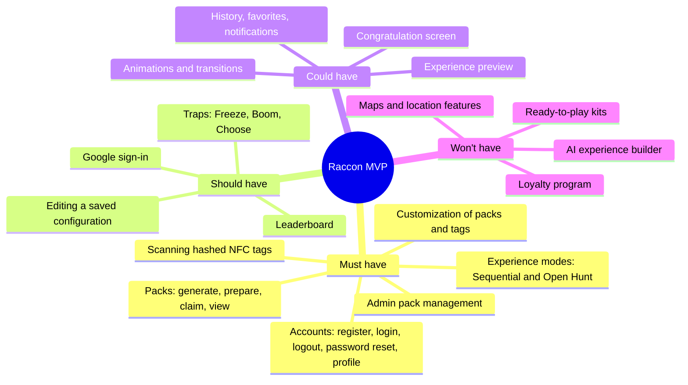
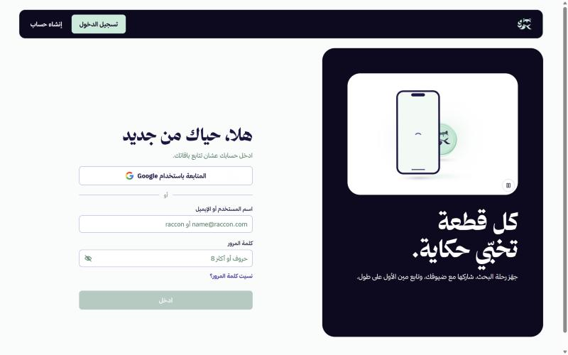
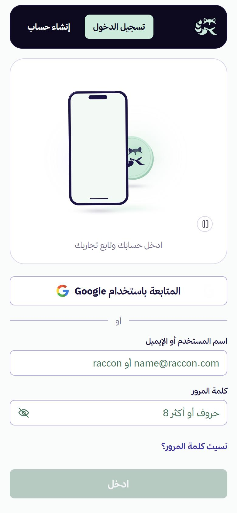
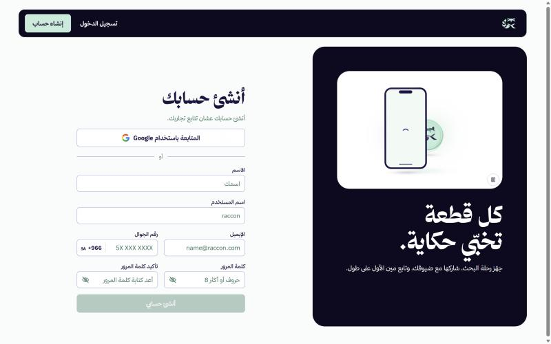
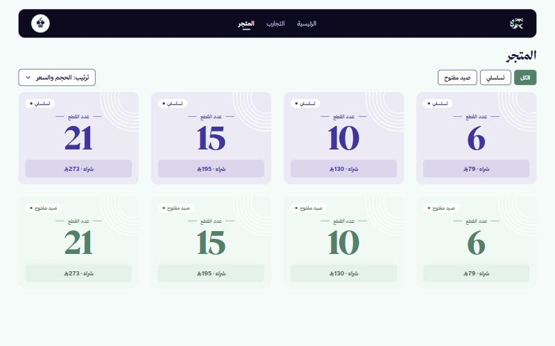
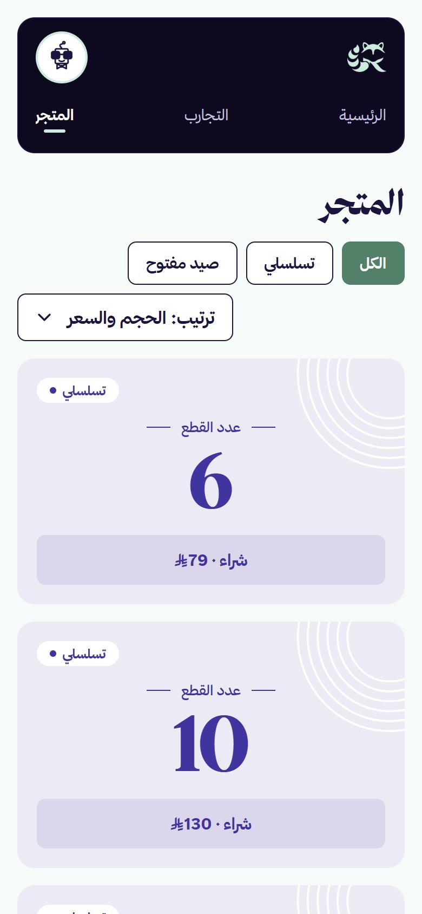
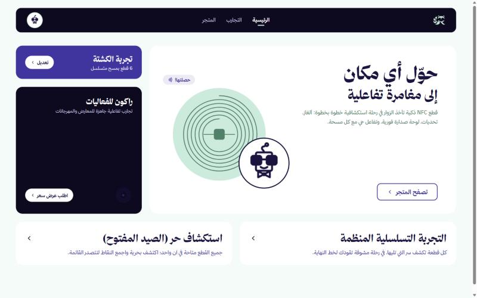
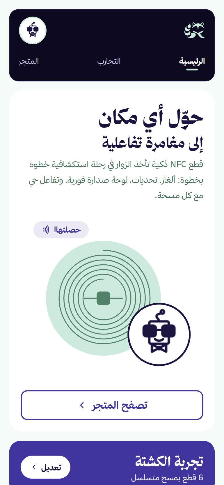
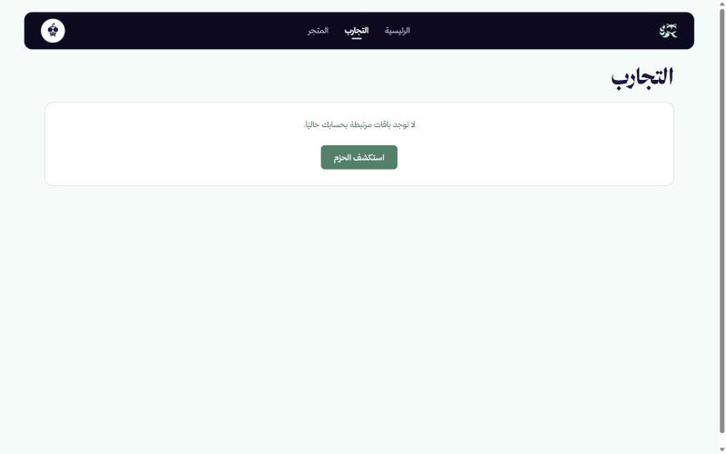
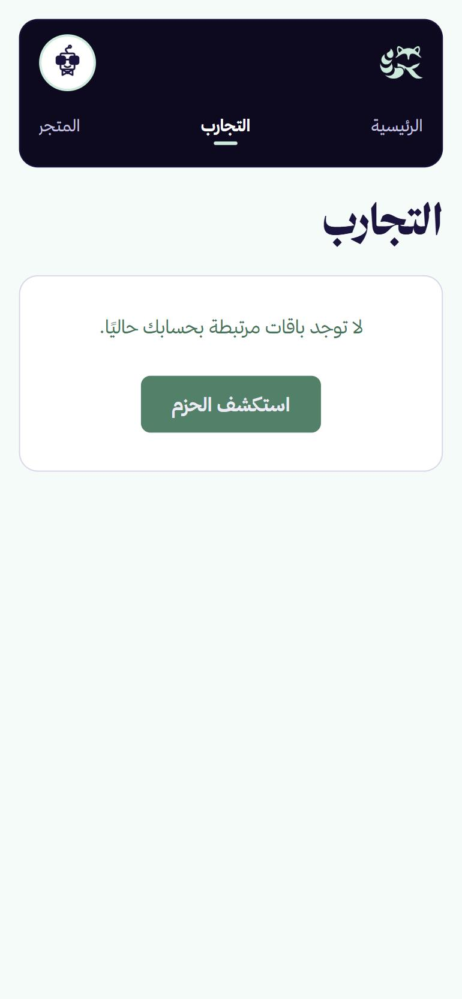

# Stage 4: MVP Development and Execution

**Project:** Raccon, an NFC treasure-hunt platform where owners buy and customize tag packs and players scan them in Sequential or Open Hunt mode.

**Team EAGO**

| Member | Role | Responsibilities |
|---|---|---|
| Osama Alhamdan | Technical Lead, Full-stack | Leads technical decisions and the system architecture; maintains the repository, deployment and infrastructure; develops backend and frontend features |
| Abdulrahman Alsalhi | Frontend Lead, Solution Architect | Leads frontend development and its architecture; reviews frontend work; develops frontend features and tests |
| Eman Hamdan | User Experience and Business Lead, Frontend | Leads the user experience, brand and UI/UX design, and the business side; develops frontend features |
| Ghaida Alsabti | Quality Assurance Lead, Backend | Leads quality assurance and testing; runs the daily stand-ups, the Trello board and the GitHub branches; develops backend features |

**Period:** 3 October 2026 to 21 November 2026, one setup sprint and four development sprints.

**Tools:** Trello (planning and tracking), GitHub (source control, pull requests, GitHub Actions), Discord (team communication and merge notifications), Figma (design), Cloudflare Pages and Render (deployment).

---

## 0. Plan and Define Sprints

### 0.1 Breaking down user stories

Each user story from Stage 3 is a Trello card, broken down into smaller tasks in three checklists: **Backend**, **Frontend** and **QA**. Each card has labels for the area (back-end, front-end, design) and the user (Owner, Player, Admin), and the members who own it.

Trello numbers the stories slightly differently from the Stage 3 document, because Log In and Log Out share one card. This document uses the Trello numbers.

| Trello | Stage 3 | Story |
|---|---|---|
| US-01 | US-01 | Registration |
| US-02 | US-02, US-03 | Log In and Log Out |
| US-03 | US-04 | Forgot Password |
| US-04 | US-05 | Manage Account |
| US-05 | US-06 | Claim a Purchased Package |
| US-06 | US-07 | View and Manage Purchased NFC Packages |
| US-07 | US-08 | NFC Package Customization |
| US-08 | US-09 | Customize Tag Content |
| US-09 | US-10 | Edit a Saved Package Configuration |
| US-10 to US-12 | US-11 to US-13 | Configure Freeze, Boom and Choose Traps |
| US-15 | US-16 | Scan a Hashed NFC Tag |
| US-16, US-17 | US-17, US-18 | View Successful Sequential and Open Hunt Scan Result |
| US-18, US-19 | US-19, US-20 | Experience a Freeze Trap and a Boom Trap |
| US-20 | US-21 | View Leaderboard |
| US-21 | US-22 | Prepare an NFC Package |
| US-22 | (supporting operation) | Generate NFC Packages |

### 0.2 Prioritization (MoSCoW)

The scope agreed in Stage 2 was prioritized with MoSCoW, then each user story was given a priority before it was placed in a sprint. **Must have** stories were planned first, because the MVP cannot work without them.



| Priority | User story | Why this priority | Sprint |
|---|---|---|---|
| **Must** | US-01 Registration | Every owner and player needs an account. | 1 |
| **Must** | US-02 Log In and Log Out | Protects owner data and personal experiences. | 1 |
| **Must** | US-03 Forgot Password | Users must be able to recover their account. | 1 |
| **Must** | US-04 Manage Account | Users update their profile and delete their account. | 2 |
| **Must** | US-21 Prepare an NFC Package | Packs must exist before anyone can buy them. | 2 to 4 |
| **Must** | US-22 Generate NFC Packages | Creates the packs and tags sold in the store. | 3 to 4 |
| **Must** | US-05 Claim a Purchased Package | Links a bought pack to the owner's account. | 3 |
| **Must** | US-06 View and Manage Purchased NFC Packages | Owners need to see the packs they own. | 3 |
| **Must** | US-07 NFC Package Customization | Owners set up their experience in Sequential or Open Hunt mode. | 3 |
| **Must** | US-08 Customize Tag Content | Each tag needs its own hint or content. | 3 |
| **Must** | US-15 Scan a Hashed NFC Tag | Scanning is the core action of the game. | 3 |
| **Must** | US-16, US-17 Scan results (Sequential and Open Hunt) | Players must see the result of each scan. | 3 to 4 |
| **Should** | US-09 Edit a Saved Package Configuration | Lets owners fix mistakes, limited to three edits per tag. | 2 to 3 |
| **Should** | US-10 to US-12 Configure Freeze, Boom and Choose Traps | Adds challenge to Open Hunt; the game works without them. | 3 to 4 |
| **Should** | US-18, US-19 Experience a Freeze Trap and a Boom Trap | The player side of the traps. | 4 |
| **Should** | US-20 View Leaderboard | Adds competition between players. | 4 |
| **Should** | Google sign-in | Faster sign-up; email sign-in already covers the need. | 2 and 4 |
| **Could** | US-13, US-14 Preview Sequential and Open Hunt Tag Experience | Helpful for owners, not required to play. | Not in MVP |
| **Could** | Animations, congratulation screen | Improves the experience but not the core flow. | 4 (animations) |
| **Won't** | Loyalty program: built later by extending the leaderboard (points and rankings across experiences) | Out of MVP scope; the leaderboard is the base it will grow from. | Future |
| **Won't** | Maps and location-based features: locations saved in NFC tags, or players tracked on a live map | Out of MVP scope; to be studied in the future. | To be studied |
| **Won't** | AI experience builder: the user answers a short form and an AI agent generates a ready-to-play experience (mode, tag content, hints and traps) | Planned after the MVP; the MVP covers manual customization first. | Future |
| **Won't** | Ready-to-play kits: kits sold with a pre-made experience that the user can play right away and still customize | Planned after the MVP; needs a library of ready experiences. | Future |

### 0.3 Sprint plan

| Sprint | Dates | Goal | Main tasks | Subtasks | Priority |
|---|---|---|---|---|---|
| **Sprint 0** | 3 Oct to 12 Oct | Setup and design foundations | Docker, configuration, Alembic migrations, Axiom logging, registration rules, profile and change-password endpoints; design tokens, brand, logo and account screens | `GET /health/` endpoint<br>Docker and `config.py` app settings<br>Alembic migrations<br>Axiom logging and monitoring<br>Registration rules<br>`GET` and `PATCH /users/me`<br>`/auth/change-password`<br>Semantic colours, brand palettes, typography, spacing and radius<br>Logo, brand guideline and brand identity<br>Account screen designs (US-01 to US-04) | Must |
| **Sprint 1** | 13 Oct to 19 Oct | Accounts | Pack, tag and event tables; CORS; forgot password (US-03); registration (US-01); login page (US-02) | Pack, tag and event tables<br>CORS<br>`/auth/register` endpoint<br>`/auth/forgot-password` and `/auth/reset-password`<br>Reset token with the password hash as an extra claim<br>`/auth/login` and `/auth/logout`<br>Login form validation, error handling and show/hide password<br>Login and logout integrated with FastAPI<br>Protected routes and session kept after page refresh | Must |
| **Sprint 2** | 20 Oct to 31 Oct | Backend architecture, OAuth and editing | Logging; sign-in validation and Google button (US-02); N-tier refactor; event editing (US-09); Google OAuth; admin pack list (US-21); home page and role-based navbar; first release to `main` | Backend refactor to the N-tier design pattern<br>Google OAuth on the backend<br>Sign-in and sign-up validation and Google button<br>`events/{event_id}/edit` endpoint and `edit_count` column<br>`GET /admin/packs` endpoint<br>Home page<br>Role-based navbar<br>Release pull request `Dev` to `main` | Must, Should |
| **Sprint 3** | 1 Nov to 9 Nov | Packs, claim, customization and scan | Core system; store and claim (US-05, US-06); factory (pack generation); customization (US-07, US-08); scan service (US-15); CI pipeline; scan page (US-16 to US-19); image upload; second release to `main` | Admin and user roles in the database<br>`/admin/generate-packs` endpoint<br>`/packs/claim` and `/packs/preview/{hash}`<br>`GET /events` and `GET /events/{event_id}`<br>`/events/{event_id}/setup` and `PATCH /events/{event_id}`<br>Customization editor, tag selector and round settings<br>Freeze, Boom and Choose trap configuration (US-10 to US-12)<br>`/journey/scan` and `/journey/set-trap`<br>Sequential and Open Hunt scan results, freeze and boom trap screens<br>Image upload<br>GitHub Actions CI and email validation<br>Release pull request `Dev` to `main` | Must |
| **Sprint 4** | 10 Nov to 21 Nov | Leaderboard, admin and quality | Real-time leaderboard (US-20); profile page; Ramz store links; backend unit tests; pack preparation and claim-link export (US-21, US-22); rebuild codes; frontend structure and test suite; account, store and admin redesign; third release to `main` | `journey/leaderboard/{event_id}` endpoint, scan timestamp and real-time updates (SSE)<br>Leaderboard component with live data<br>Profile page<br>Ramz links in the store<br>Backend unit tests<br>`/admin/factory/pack/{pack_id}` and mark-printed endpoints<br>Claim-link export<br>Rebuild codes<br>Feature-based frontend structure and test suite<br>Account, store and admin page redesign<br>Release pull request `Dev` to `main` | Should, Could |

---

## 1. Execute Development Tasks

### 1.1 Coding standards and source control

| Practice | How it was applied |
|---|---|
| Branching | `Dev` is the integration branch. During the development phase `Dev` is deployed (raccon.app); after the MVP is complete, only `main` will be deployed. `main` is the stable release branch. Each user story or fix has its own branch from `Dev` (`US-xx`, `TS-xx`, `fix/...`, `refactor/...`). |
| Pull requests | Every change reaches `Dev` through a pull request (49 in total). Backend and frontend teams were reviewing their team members' pull requests and merging them. `Dev` is promoted to `main` through release pull requests (#10, #31 and #43). |
| Commit convention | `feat:`, `fix:`, `refactor:`, `chore:` and `style:`, as defined in our [SCM and QA plan](https://github.com/t8pr/Raccon/blob/main/Mentors/Paper/scm-qa.md). |
| Continuous integration | [`backend-unit-tests.yml`](https://github.com/t8pr/Raccon/blob/main/.github/workflows/backend-unit-tests.yml) runs the backend tests on every pull request into `Dev` or `main`. [`discord-dev-merge.yml`](https://github.com/t8pr/Raccon/blob/main/.github/workflows/discord-dev-merge.yml) notifies the team on Discord after every merge into `Dev`. |
| Structure | The backend follows an N-tier structure (routers, services, repositories). The frontend uses a feature-based structure, with shared components, design tokens and tests next to the code. |

### 1.2 Work delivered per sprint

| Sprint | Delivered | Pull requests |
|---|---|---|
| Sprint 1 | Pack, tag and event tables; CORS; password reset with email; registration fix; login page | #1 to #5 |
| Sprint 2 | Logging; user and event schemas; sign-in validation and Google button; first release to `main`; N-tier refactor; event editing; Google OAuth; admin pack list; frontend pages | #7 to #16 |
| Sprint 3 | Core system; store and claim; home, navbar and admin pages; factory; customization; reset event and NFC scan service; email validation; CI workflow; second release to `main`; scan page; image upload | #17 to #33 |
| Sprint 4 | Real-time leaderboard; profile page; Ramz store links; backend unit tests; leaderboard refactor; pack preparation and claim-link export; database improvements; rebuild codes; third release to `main`; redesigned account pages and Google sign-in; claim, customization and account fixes; store and admin redesign | #34 to #49 |

### 1.3 QA during each sprint

QA test cases are written in the **QA** checklist of each story card and run when the story reaches the **UAT** column. A story that fails moves to the **Bug** column and returns to **MERGED** once it passes (Section 2.3). Backend tests run automatically on every pull request.

---

## 2. Monitor Progress and Adjust

### 2.1 Daily stand-ups

The team holds a short stand-up every day, in person at Holberton or in the Discord **stand-up** voice channel when a member is remote. Each member shares what they finished, what they will do next and any blockers. The stand-ups that led to decisions or changes to the plan were written down:

| Date | Progress reported | Decisions and adjustments |
|---|---|---|
| 21 Oct | Figma mockups and logo reviewed with mentors; registration, login and the welcome page done; backend about 80% complete | No timer toggle and no hashing toggle in the MVP, because tags are always hashed. A backend developer supports the frontend. A frontend Dockerfile and roadmap were added to the plan. |
| 29 Oct | Store, account management and half of the claim flow done; forgot password, backend refactor, event editing and the Google client done | Next: claim, admin frontend, home and customization pages. The backend exposes scores, fixes the Open Hunt counter and handles redirects between Raccon domains. |
| 4 Nov | Admin page, customization layout and data fetching, NFC factory tool and reset endpoint done | Frontend structure refactor planned with a team walkthrough. Endpoints added for deleting packs and managing users. Tag links made harder to guess. |
| 10 Nov | Customization, GitHub Actions, dynamic scan journey and image upload done | Store checkout uses Ramz while experiences stay in our backend. A real-time leaderboard was planned without overloading the database. |
| 11 Nov | Login page, intro animation, store design, Ramz and the Cloudflare integration with raccon.link done | Designs are finalized before implementation starts. Next: scan pages, claim endpoint, real-time leaderboard and stronger forgot-password protection. |
| 15 Nov | Scan pages, store pages, leaderboard, DNS and Ramz done | Pair session to update npm packages. Next: Google sign-in, admin endpoints, unit tests and CI/CD, claim preview endpoint. |
| 17 Nov | Frontend tests and refactor, register, login, Google sign-in, backend tests, claim preview endpoint and Ramz design done | Next: leaderboard with user ranking, Redis hosting, protection of the forgot-password endpoint and secure sessions with HttpOnly cookies. |

### 2.2 Task tracking on Trello

Cards move through **backlog → in dev → code review → UAT → Done → MERGED**, which shows the status of every story at any time. Tasks inside each card are ticked as they are completed.

### 2.3 Metrics

**Velocity (user stories merged per sprint)**

| Sprint | Stories merged | Count |
|---|---|---|
| Sprint 2 | US-01, US-02, US-04 | 3 |
| Sprint 3 | US-03, US-05, US-06, US-07, US-08, US-09, US-15 | 7 |
| Sprint 4 | US-10, US-11, US-12, US-16, US-17, US-18, US-19, US-20, US-21, US-22 | 10 |

**Tasks completed:** 129 of the 152 checklist tasks on story cards are done (85%).

**Pull requests and releases**

| | Sprint 1 | Sprint 2 | Sprint 3 | Sprint 4 | Total |
|---|---|---|---|---|---|
| Pull requests merged | 5 | 10 | 15 | 15 | 45 |
| Releases to `main` | 0 | 1 | 1 | 1 | 3 |
| Bugs fixed | 1 | 1 | 5 | 7 | 14 |

**Bug resolution rate:** 14 of 22 bugs found are fixed (64%). The 8 open bugs are minor and do not block the user journey (Section 4.4).

### 2.4 Adjustments made

- A backend developer took on frontend support tasks (21 Oct).
- The timer and hashing toggles were removed from the MVP scope (21 Oct).
- The frontend was restructured into a feature-based structure, with a walkthrough for the team (4 Nov to 17 Nov).
- Designs are finalized before implementation, after developers asked for stable designs (11 Nov).
- Real-time leaderboard updates were designed to avoid overloading the database (10 Nov).

---

## 3. Sprint Reviews and Retrospectives

### 3.1 Sprint reviews

At the end of each sprint, the completed features were demonstrated to the team and checked against the sprint goal.

| Sprint | Completed features presented | Result |
|---|---|---|
| Sprint 1 (19 Oct) | Registration, login and password reset; pack, tag and event tables | Users can create an account and sign in. |
| Sprint 2 (31 Oct) | N-tier backend, Google OAuth, event editing, admin pack list, home page and navbar | The first stable release reached `main`. |
| Sprint 3 (9 Nov) | Store, claim, customization, factory, scan service and scan page, image upload, CI | An owner can claim a pack, customize it and play it by scanning its tags. |
| Sprint 4 (21 Nov) | Real-time leaderboard, profile, admin pack preparation and claim-link export, rebuild codes, test suites, redesigned account, store and admin pages | The MVP is complete and deployed at https://raccon.app. |

### 3.2 Retrospectives

| Sprint | What worked well | Challenges | Changes for the next sprint |
|---|---|---|---|
| Sprint 1 | The data model was ready early, so later stories had a stable base. | One pull request (#1) combined six user stories, which made it hard to review. | One branch per user story. |
| Sprint 2 | The first release reached `main`, and the N-tier refactor made the backend easier to extend. | A release to `main` was opened before `Dev` was ready (#6, closed). | Release to `main` only after the team checks `Dev` together. |
| Sprint 3 | The busiest sprint (15 pull requests), and CI now tests every pull request. | Two feature branches were merged into each other instead of into `Dev` (#22, #23). | Every branch starts from the latest `Dev` and targets `Dev`. |
| Sprint 4 | Backend and frontend test suites were added, and pair sessions helped the team move faster. | Few pull requests had a reviewer assigned; one pull request (#48) targeted `main` instead of `Dev`; line-ending differences (CRLF) made some diffs hard to read; developers asked for stable designs. | Every pull request gets a reviewer, the base branch is checked before opening a pull request, LF line endings are standard, and designs are handed off in Figma before coding. |

---

## 4. Final Integration and QA Testing

### 4.1 Integration

The React frontend calls the FastAPI backend for every feature (accounts, store, claim, customization, scan, leaderboard and admin). Frontend page tests run each page against a mock of the real API responses (MSW), and the backend route tests run against a PostgreSQL test database. Together, these tests cover every main flow end to end: register, log in, browse the store, claim a pack, customize it, scan tags and view the leaderboard. The manual test plan below was run on the deployed app.

### 4.2 Automated tests

| Layer | Tools | Scope | Result |
|---|---|---|---|
| Backend unit tests | pytest | Auth, event, journey (scan) and pack services | 21 tests passed |
| Backend integration tests | pytest, PostgreSQL | Auth routes | 2 tests passed |
| Frontend unit and component tests | Vitest, React Testing Library | Utilities, validation and shared components | Included below |
| Frontend page tests | Vitest, MSW, user-event | Account, home, store, claim, customization, packages, scan, leaderboard, profile and admin pages | Included below |
| **Frontend total** | | 57 test files | **595 tests: 591 passed, 4 known bugs written as expected failures** |
| Production build | react-scripts | Frontend bundle | Builds with no errors |

**Continuous integration:** the backend test workflow has run on 16 pull requests since 5 Nov, and all runs passed. Each run publishes a JUnit report as the **Backend test results** check. Runs: https://github.com/t8pr/Raccon/actions

**Running the tests:** the backend tests need a PostgreSQL test database and the environment variables listed in `backend-unit-tests.yml`.

```bash
# backend
cd backend
pip install -r requirements.txt
python -m pytest tests -v

# frontend
cd frontend/raccoon
npm install
npm test
```

### 4.3 Manual test plan results

| Story | Test cases | Result |
|---|---|---|
| US-01 Registration | TC-01 valid registration; TC-02 username or email already taken; TC-03 invalid name, username or email; TC-04 missing field; TC-05 email format | 5 of 5 passed (TC-05 failed first and was fixed) |
| US-02 Log In and Log Out | TC-01 valid login; TC-02 invalid username; TC-03 invalid email format; TC-04 empty fields; TC-05 unregistered user; TC-06 redirect after logout | 6 of 6 passed |
| US-04 Manage Account | TC-01 edit account fields; TC-02 field length validation | 2 of 2 passed (2 bugs found and fixed) |
| US-08 Customize Tag Content | TC-01 cancel an edit | 1 of 1 passed |
| US-09 Edit a Saved Package Configuration | TC-01 edit an unfinished Open Hunt event; TC-02 adding an image enables Save; TC-03 reset-required error | 2 of 3 passed (1 minor bug open, K-07) |
| US-12 Configure Choose Trap | TC-01 tag behavior after a trap is chosen | 1 of 1 passed |

### 4.4 Bug tracking

Bugs are tracked in three places: the **Bug** column and **QA/Bugs** checklists on Trello, `fix:` pull requests on GitHub, and expected-failure tests (`test.fails`) that keep known bugs visible in every test run.

**Fixed (14)**

| ID | Bug | Fix | Sprint |
|---|---|---|---|
| B-01 | Registration did not store the user's avatar | PR #4 | 1 |
| B-02 | Sign-in and sign-up accepted invalid data | PR #9 | 2 |
| B-03 | Email format was not validated at registration | PR #28, #29 | 3 |
| B-04 | Wrong title in the CI notification message | PR #30 | 3 |
| B-05 | Username and name had no maximum length | Trello US-04 | 3 |
| B-06 | A user could not delete their account while they had an event | Trello US-04 | 3 |
| B-07 | Adding an image to a tag did not enable the Save button | Trello US-09 | 3 |
| B-08 | On the customization page, saving each tag in edit mode used up one of the pack's available edits | PR #45 | 4 |
| B-09 | The session token was kept in sessionStorage, so the user was signed out when the tab was closed or the app was opened in a new tab | PR #45 | 4 |
| B-10 | The Google sign-in button crashed on resize (null reference in its resize observer) | PR #45 | 4 |
| B-11 | After buying a pack, login did not return the user to the claim page | PR #46 | 4 |
| B-12 | No confirmation was shown before signing out a deleted account | PR #47 | 4 |
| B-13 | The Google button showed a loading spinner during a normal sign-up | PR #44 | 4 |
| B-14 | Scan links lost their signature when switching between login and register | PR #44 | 4 |

**Open (8, none critical)**

| ID | Bug | Where |
|---|---|---|
| K-01 | A short password shows no error message on the login form | Login form |
| K-02 | The hint image message says 2048 px, but the real limit is 1200 px | Customization |
| K-03 | Keyboard focus is lost after saving an experience name | Customization |
| K-04 | Screen readers cannot read the error if logout fails | Profile menu |
| K-05 | An invalid NFC tag shows a generic error message | Scan page |
| K-06 | Claiming a pack the user already owns returns HTTP 400 instead of success | Backend |
| K-07 | The "resetting the Open Hunt event is required" error is not handled | Edit page |
| K-08 | Google sign-in on raccon.app is blocked (origin_mismatch); username and password sign-in works | Google Cloud OAuth settings |

### 4.5 Production screenshots

Taken on https://raccon.app on 21 Nov 2026, at laptop (1440 px) and phone (390 px) sizes.

| Page | Laptop | Phone |
|---|---|---|
| Login |  |  |
| Register |  | |
| Store |  |  |
| Home |  |  |
| Experiences |  |  |

---

## 5. Deliverables

| Deliverable | Link |
|---|---|
| Sprint planning | [Section 0](#0-plan-and-define-sprints) and the Trello board: https://trello.com/b/DQxxyR2i/raccon |
| Sprint reviews | [Section 3.1](#31-sprint-reviews) |
| Retrospectives | [Section 3.2](#32-retrospectives) |
| Source repository | https://github.com/t8pr/Raccon |
| Bug tracking | [Section 4.4](#44-bug-tracking) |
| Testing evidence and results | [Section 4](#4-final-integration-and-qa-testing) and https://github.com/t8pr/Raccon/actions |
| Production environment | https://raccon.app (frontend on Cloudflare Pages, backend API on Render) |
